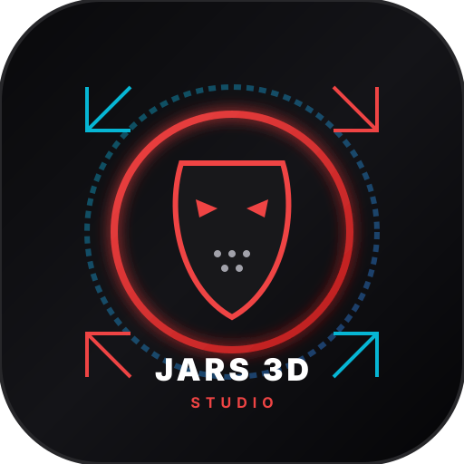

# Jars 3D Studio — Android Release APK & AI Movie Maker



> **Real-Time 3D Movie Studio & Virtual Streamer Engine** with Procedural Environments, Physics-Based Character Animation, Custom Speech Blips, AI Auto-Rigging, and TikTok Live Mobile Gaming Integration.

---

## 📱 Android Release APK (GitHub Official Release)

Download the official standalone Android Release APK directly to your phone or tablet:

| Release Attribute | Details |
| :--- | :--- |
| **Latest Version** | `v1.0.0-android` |
| **Package Name** | `com.jars.ai3d.studio` |
| **Direct APK File** | [`jars-3d-studio-v1.0.0.apk`](public/downloads/jars-3d-studio-v1.0.0.apk) |
| **Direct Server URL** | [`/api/download/apk`](https://ais-dev-tukpr3f6xf4fdlm45uohix-387092968143.us-west2.run.app/api/download/apk) |
| **GitHub Releases** | [github.com/charlestheii67/jars-3d-studio/releases/latest](https://github.com/charlestheii67/jars-3d-studio/releases/latest) |
| **SHA-256 Checksum** | `2c00140087f3d4b4f4c4ddba512ed2da027a769cdb9b7c923f09969c340737e2` |
| **Target Android** | Android 14+ (API Level 34) |
| **Minimum Android** | Android 8.0 Oreo (API Level 26)+ |

---

## 🚀 How to Install the APK on Android

1. **Download the APK**:
   - Tap the **Download Release APK** button in the app HUD or download directly from [GitHub Releases](https://github.com/charlestheii67/jars-3d-studio/releases/latest).
2. **Open the File**:
   - Swipe down the notification shade and tap `jars-3d-studio-v1.0.0.apk` (or open via Android **Files / My Files** -> **Downloads**).
3. **Allow Installation from Unknown Sources**:
   - If prompted by Android security (*"For your security, your phone is not allowed to install unknown apps from this source"*):
   - Tap **Settings** -> Toggle **Allow from this source**.
4. **Complete Installation**:
   - Tap **Install**.
   - Tap **Open** to launch Jars 3D Studio in full-screen hardware-accelerated 3D mode!

---

## 🎮 TikTok Live Mobile Gaming Setup with the Android App

1. Launch **TikTok** on your Android device and tap the **+** (Create) button.
2. Swipe to the **LIVE** tab at the bottom.
3. Under live options, select **Mobile Gaming**.
4. Set your stream title (e.g., *"3D AI Avatar Interactive Stream"*), choose your game/category, and tap **Go LIVE**.
5. Switch to **Jars 3D Studio** (or open in split-screen / floating overlay).
6. In Jars 3D Studio, tap the **TikTok Live** tab, authorize your TikTok account, and watch your 3D avatar interact with live chat questions in real-time with synchronized speech blips and live captions!

---

## 🛠️ Building the APK from Source

### Option A: Gradle & Android Studio
```bash
cd android
./gradlew assembleRelease
# The output APK will be in:
# android/app/build/outputs/apk/release/app-release.apk
```

### Option B: Bubblewrap CLI (TWA)
```bash
npm install -g @bubblewrap/cli
bubblewrap build --manifest=twa-manifest.json
```

### Option C: GitHub Actions CI/CD
Every tag pushed starting with `v*` (e.g., `git tag v1.0.0 && git push origin v1.0.0`) or manual trigger via the **Actions** tab triggers `.github/workflows/android-release.yml`, building the APK and publishing a new release with the binary asset attached.

---

## 🌟 Key Features

- **3D Character Physics Animation**: 15 categorized animations (Slasher Stalk, Dynamic Leap, Ragdoll Shock, Martial Combo, TikTok Dance, Evil Laugh, etc.).
- **Custom 3D Model Importer & AI Auto-Rigging**: Import `.obj` / `.gltf` with automatic 18-joint kinematic bone generation, jaw socket binding, and neon skeleton visualizer.
- **Custom Speech Blip Engine**: Procedural speech blips (Slasher Grunt, 8-Bit Retro, Cyber Synth, Animal Speak, etc.) and custom audio sound effect upload (`.wav`, `.mp3`) with real-time viseme lip-sync.
- **Dynamic Captions**: Cinema, TikTok Viral Bold, Retro RPG, and Horror Whisper subtitles.
- **TikTok Live Mobile Gaming Streaming**: Real screen vision analysis and real chat Q&A response without simulated bots.
